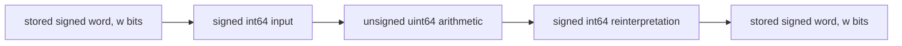

# Signed promotion/narrowing bridge and frozen independent-review packet

Eight general support theorems connect modular word laws to the typed evaluator's
signed input widening, unsigned arithmetic, result reinterpretation and narrowing.
The native matrix now covers12 Add/Subtract/Multiply/Negate recipes at all four
built-in signed widths:144 runs. Raw word bits and actual signed observations
agree with48 Lean vectors and a separate modulo/signed-decoding reference.

A separate frozen packet is ready for independent census/pilot review. No
reviewer has been assigned and no independent result is claimed. Source
acceptance remains zero; the semantic denominator and whole-file verdict remain
open. The packet freezes the preceding2299-line basis; the new signed bridge
is a later46-line extension that requires its own review before acceptance.

XLA pin: e58e523b11f1fde802a493a776d158007486e1bf. Target SHA256:
1ecfd7d4ba958ac0e795d8663c14f7f6b1ebd147a8a83ed0e99661740105628f.
The pass implementation is unchanged. Lean4.35.0/Std remain pinned.

## Actual source arithmetic

The source does not simply perform narrow signed C++ arithmetic. Typed visitor
dispatch at hlo_evaluator.cc877–910 selects int64_t elementwise computation for
signed primitive types. The int8/int16/int32 instantiation files explicitly use
HloEvaluatorTypedVisitor<ReturnT,int64_t>; int64's default is the same type.
ToArithmeticSafeType in the typed visitor header87–109 converts integral
computations to an unsigned promoted type to force two's-complement behavior.
Add/Subtract/Multiply use that helper before arithmetic, then the evaluator
casts the result through ElementwiseT and ReturnT.

For the inspected built-in signed types, the binary path is:

Negate is a distinct source path: it explicitly converts to the unsigned type
of ReturnT, negates and casts back. It must not be described as the identical
64-bit binary helper. The source and dtype profiles, including this difference,
are pinned in sources/signed-arithmetic-contract-manifest.json and
census/signed-word-contract.json. Integer C++ promotions during narrow unsigned
Negate and the target's signed representation remain source/cast correspondence
facts; the new word proofs do not claim a verified C++ compiler or ABI.

## Kernel bridge

PromotedWordArithmetic proves:

| Support theorem | Guarantee |
| --- | --- |
| narrow_ofInt | Encoding in p bits then narrowing to w matches direct w-bit encoding when w≤p |
| signed_promotion_exact | Signed widening preserves the decoded integer when w≤p |
| signed_cast_narrow | Reinterpreting an intermediate as signed preserves its narrowed bits |
| promoted_add | Wider unsigned Add narrows to the original modular Add |
| promoted_mul | Wider unsigned Multiply narrows to the original modular product |
| promoted_sub | Wider unsigned Subtract narrows to the original modular difference |
| promoted_neg | Negation/narrowing preserves the word even at signed minimum |
| tensor_signed_decode_injective | Equality of fixed-width signed tensor observations is equivalent to equality of words |

The promotion bound is explicit and essential; a kernel control shows that a
four-bit intermediate loses information from an eight-bit input. There are no
no-overflow assumptions. The laws quantify over arbitrary widths/shapes where
applicable, and w≤64 holds for every inspected stored dtype. The source's actual
64-bit intermediate is pinned rather than inferred from agreement of values:
correct modular narrowing can make different sufficiently wide intermediates
observationally indistinguishable.

These eight support bridges relate to33 existing Add/Multiply/Subtract word
laws; they do not create33 new source proofs or new rule count. Source constant/
matcher/dtype, graph/API/frame and backend observation correspondence still need
review. In particular, the inspected host evaluator is not a proof about every
backend. Floating, complex and custom subbyte representation contracts remain
explicit obligations in the whole-file experiment.

## Signed execution and model controls

Fixture: tests/xla/signed_word_replay_test.cc.
Current immutable archive: reports/signed-word-replay-v2. V1 preserves the prior
successful96-run eight-recipe matrix; v2 extends it to subtraction and double
Negate, rather than counting the overlapping runs as independent experiments.
Both archives retain exact fixtures/BUILD, commands/events, logs, XML and hashes.

The12 recipes are Add zero, constant movement, Add association, shared factoring,
Multiply zero/one, negated operands, four-factor gathering, Subtract self/zero/
constant, and double Negate. Each has direct-handler/full-pass/no-rewrite modes
at s8/s16/s32/s64. Inputs include signed maximum, signed minimum, minus one,
adjacent boundary words and zero, with independent other/shared operands. All
intended rewrites fire, all controls remain unchanged and every output graph
passes HloVerifier. There are864 checked output cells, also checked before the
rewrite.

The C++ oracle uses unsigned word arithmetic and bit_cast for signed literals,
with no signed-overflow reference expression. The test prints both raw bits
and actual signed values returned by native HloEvaluator. The separate Python
reference uses arbitrary-precision arithmetic modulo2^w and mathematical signed
interpretation. Lean evaluates signed input widening to64 bits, unsigned word
operations, signed result interpretation and narrowing at each binary node.
Its48 vectors match every native/raw/signed result. Separate implementations
and same-agent replay are not independent semantic/source review.

At s8, maximum127 plus2 has bits129 and signed value−127. Minimum−128 remains
−128 under modular Negate; a false unbounded Int-negation claim is rejected by
the kernel. These distinctions prevent treating the signed values as unsigned
magnitudes or unbounded integers. Signed tensor decoding is injective, so the
word observation is not a weakened equality that hides different signed outputs.

## Independent review readiness

reviews/packets/census-pilot-v1.md gives an actionable whole-census and20-target
semantic/statement inspection. The zip freezes560 inputs and a complete hash
manifest: all487 provisional schemas, source/contracts, structured typed records,
Lean/tests, reports/native evidence and tooling/parser packages. Large raw Clang
and historical TensorRight artifacts remain separately pinned, not silently
included in a hermetic bundle. The frozen archive's contents were hash-verified.

The descriptor census-pilot-v1.json states ready_for_independent_review_not_reviewed,
reviewer_assigned=false and review_result=null. The packet prevents self-review
promotion, requires explicit coverage/remaining-gap reporting and distinguishes
value proofs, source counterexamples, evaluator diagnostics and extraction.
It permits reviewed source-to-theorem mapping; a verified C++ extractor is not
an added completion requirement. Accountable human/checked-translation evidence
for final source acceptance remains as specified by the agreed campaign plan.

A reviewer choice was requested through the user-input UI because session rules
prohibit spawning subagents without explicit authorization. No answer has been
assumed. Other authorized proof work has continued; no agent was spawned or
independent review marked complete. The frozen packet isolates the review from
later live-workspace changes.

## Validation and measured artifact

The current checkpoint passes54 tool/evidence tests, all Lean proofs/axiom audits,
positive model probes, negative controls and archived native checks. A mutation-
test sandbox initially omitted the canonical source file; that harness input was
added before the successful rerun. No source/numerical claim is based on that
failed checkpoint. Controls reject incorrect intermediate/Negate widths, changed
raw/signed values, missing recipes, claimed source review/acceptance and mistaken
unsigned decoding in the Lean model output.

| Lean category | Previous | Current | Added |
| --- | ---: | ---: | ---: |
| S semantics | 622 | 622 | 0 |
| H shared support | 772 | 817 | 45 |
| R rule proofs | 643 | 643 | 0 |
| A imports/checking | 26 | 27 | 1 |
| C certificates | 236 | 236 | 0 |
| Total | 2299 | 2345 | 46 |

There are still71 value laws; support count is now80. Tests/audits are separately
measured. The cast/promotion proofs use audited standard propext, Classical.choice
and Quot.sound; signed tensor injectivity uses propext/Quot.sound. No unapproved
axiom or unchecked evaluator proof is introduced, and all prior axiom sets and
stricter certificate gates are retained. Scalar identities are reused from the
already-disclosed pinned Std dependency baseline.

| New non-Lean file | Physical lines | Bytes |
| --- | ---: | ---: |
| signed_word_cases.py | 37 | 1421 |
| check_signed_word_evidence.py | 108 | 8111 |
| run_signed_word_replay.py | 78 | 4326 |
| signed_word_replay_test.cc | 142 | 8013 |

snapshots/signed-word-pilot-v1.zip and reports/signed-word-clean-replay.json
preserve clean Lean replay without Lake caches, matching measurements, all model
outputs and prior axiom sets. That replay does not rebuild native XLA or supply
independent source review. Remaining work includes reviewer assignment/findings,
semantic census/pilot closure, further operator/numerical contracts and the full
campaign/diagnosis/final verdict.

Fresh Lean snapshot SHA256: 12b9f50750175b5ae0a06939854a2ee7af494f25bc812d6eba14aa32bfdcee2d.
